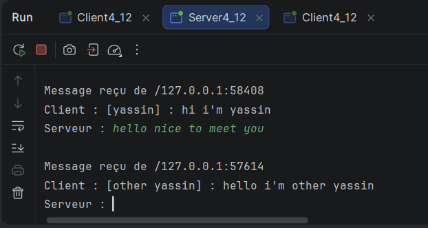
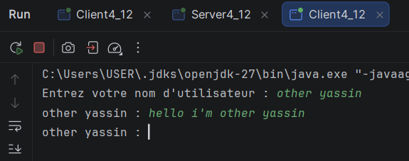

# TP4 - Sockets UDP : échange de datagrammes et chat client-serveur

**Faculté :** Faculté des Sciences de Sfax  
**Département :** Informatique et Communications  
**Niveau :** LSI 3  
**Matière :** Développement d'applications réparties  
**Étudiant(e) :** _Safi Mohamed yassine_  
**Année universitaire :** 2026-2027

## Présentation

Ce projet reprend les classes Java `Server4_1`, `Client4_1`, `Server4_12` et `Client4_12`. Il utilise des sockets UDP (`DatagramSocket`) et des paquets (`DatagramPacket`) sur le port `1234`.

Le travail est organisé en deux étapes :

1. **Étape 2 :** le client envoie des messages préfixés par son nom et le serveur les affiche avec l'adresse IP et le port de l'expéditeur.
2. **Étape 3 :** le client peut envoyer et recevoir des messages ; le serveur reçoit un message puis saisit une réponse dans sa console et la renvoie à l'expéditeur.

## Organisation des classes

```text
src/
├── serverPackage/
│   ├── Server4_1.java
│   └── Server4_12.java
└── clientPackage/
    ├── Client4_1.java
    └── Client4_12.java
```

Les noms des dossiers doivent correspondre aux packages déclarés au début des fichiers : `serverPackage` et `clientPackage`.

> Dans `Server4_1.java`, la déclaration de la méthode principale doit être `public static void main(String[] args)` pour que Java puisse lancer la classe.

## Environnement

- JDK 8 ou supérieur
- IntelliJ IDEA, Eclipse ou VS Code
- Port UDP : `1234`
- Encodage conseillé pour les messages : UTF-8

## Étape 2 - Chat unidirectionnel et test avec un client

### Fonctionnement

- `Server4_1` lie son socket UDP au port `1234` avec `InetSocketAddress`.
- `Client4_1` demande un nom d'utilisateur et envoie chaque message au serveur sous la forme `[Nom] : message`.
- Le serveur affiche le contenu reçu. Pour afficher aussi l'expéditeur, utiliser `paquet.getAddress()` et `paquet.getPort()`.
- Le client quitte la boucle de saisie avec `/quit`.

### Exécution

1. Lancer `serverPackage.Server4_1`.
2. Lancer `clientPackage.Client4_1`.
3. Saisir un nom puis envoyer plusieurs messages.
4. Vérifier dans la console serveur les messages reçus et l'adresse/port de l'expéditeur.

Par défaut, le client utilise `localhost`. Pour une machine serveur distante, remplacer `localhost` par son adresse IP dans `Client4_1`.

## Étape 3 - Échange bidirectionnel

### Fonctionnement de la version fournie

- `Client4_12` lance un thread dédié à la réception et utilise le thread principal pour lire et envoyer les messages.
- `Server4_12` reçoit un message, l'affiche, demande une réponse dans la console du serveur et renvoie cette réponse à l'adresse et au port UDP de l'expéditeur.
- Il faut d'abord lancer le serveur, puis le client. Pour chaque message du client, le serveur saisit une réponse.

### Limite à connaître pour le test demandé dans l'énoncé

La version fournie de `Server4_12` ne conserve pas encore une liste des adresses de plusieurs clients et ne diffuse pas les messages aux autres clients. Elle réalise un échange entre le serveur et le client qui vient d'envoyer le datagramme. Pour satisfaire entièrement la partie « Diffusion à plusieurs clients », le serveur doit mémoriser les adresses des clients, puis renvoyer chaque message à tous les clients enregistrés sauf son expéditeur.

Pour tester la version actuelle, lancer le serveur une seule fois et démarrer un client. Le serveur répond depuis sa console. Plusieurs clients peuvent envoyer des datagrammes, mais le serveur doit traiter chaque réponse manuellement et les messages ne sont pas relayés automatiquement entre clients.

## Compilation et lancement depuis un terminal

Depuis la racine du projet, en supposant que les fichiers se trouvent dans `src` :

```text
javac -encoding UTF-8 -d out src/serverPackage/*.java src/clientPackage/*.java
```

Lancer une seule classe serveur à la fois, car les deux serveurs utilisent le port `1234`.

Pour l'étape 2 :

```text
java -cp out serverPackage.Server4_1
java -cp out clientPackage.Client4_1
```

Pour l'étape 3, arrêter le premier serveur puis lancer :

```text
java -cp out serverPackage.Server4_12
java -cp out clientPackage.Client4_12
```

Dans IntelliJ IDEA, créer une configuration d'exécution par classe principale. Pour ouvrir plusieurs clients, autoriser plusieurs instances de la configuration client ou lancer les clients depuis plusieurs terminaux.

## Captures d'écran et synthèse

Remplacer les indications ci-dessous par vos captures. Vous pouvez placer les images dans un dossier `captures/` du projet et utiliser des liens Markdown, par exemple ``.

### Étape 2 - Envoi unidirectionnel

**Capture 1 - Serveur**  


**Capture 2 - Client1 avec nom et message envoyé** 


**Capture 3 - Client2 avec nom et message envoyé**


### Étape 3 - Échange bidirectionnel et tests multi-clients

**Capture 1 - Serveur recevant un message et saisissant sa réponse**  


**Capture 2 - Client recevant la réponse**  


**Capture 3 - Test avec plusieurs clients**  
server:

client:


## Dépôt GitHub

**Lien du repository :** _[Coller ici le lien vers le dépôt GitHub]_

## Conclusion

_[Résumer les notions pratiquées : UDP, DatagramSocket, DatagramPacket, adresses IP/ports et réception asynchrone avec un thread._]
